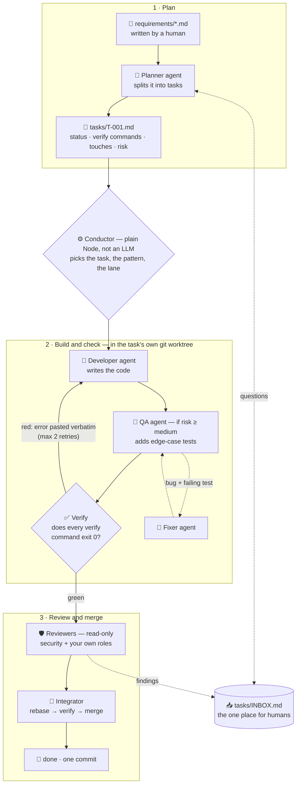
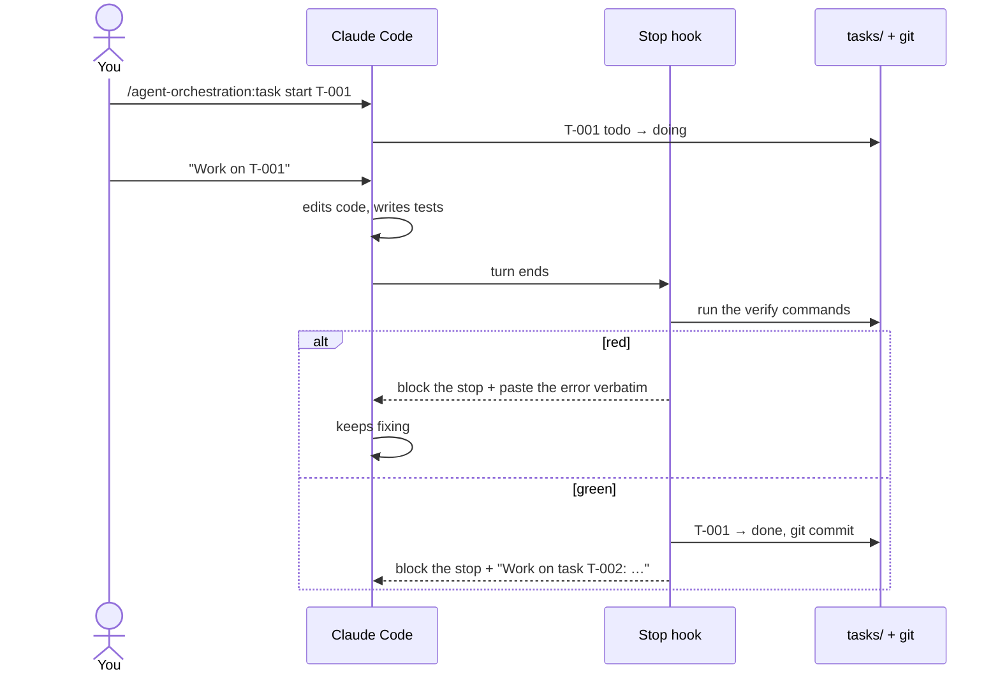
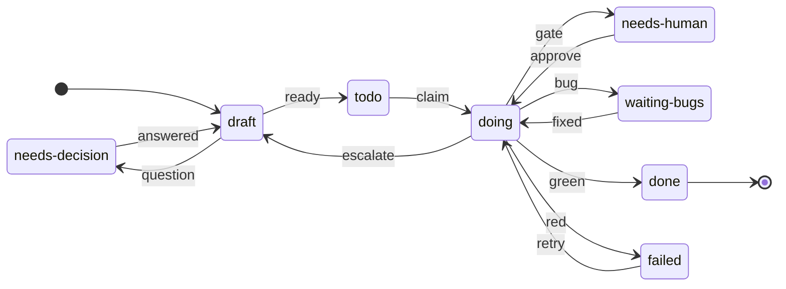

# agent-tools

[](LICENSE)

A Claude Code plugin marketplace. It currently ships one plugin:

| Plugin | Version | What it does |
|---|---|---|
| [`agent-orchestration`](plugins/agent-orchestration/README.md) | 0.2.0 | Task queue for AI agents: tasks are markdown files with front-matter, only the verifier marks a task done after its check commands pass, a Stop hook chains the next task, a planner splits requirements and asks without stopping, and a conductor runs parallel workers, QA/reviewers and a bug-fix loop. |

## How it works

**LLMs do the work, plain code decides.** Agents write code and review it; a deterministic Node program
picks tasks, runs them and decides when they are finished — the same input always gives the same decision.

### The life of one task



- **Only the verifier can mark a task `done`** — every command in the task's `verify:` must exit 0. No agent
  grades its own work; QA files bugs instead of fixing them.
- **Agents hand off through files, never transcripts:** each fresh session reads the task file, the branch
  diff and the `## Handoff log` the previous agent left.
- **Parallel only when safe:** two tasks run side by side only if their `touches` globs don't overlap and they
  hold no common lock (e.g. database migrations, lockfiles).
- **Simplest pattern that is enough:** one agent for a small task, a backend + web specialist router for a
  two-domain task, a planner → executor split for a large one; QA and security are added by risk.

### Two ways to run it

| | **Stop hook** (in your interactive session) | **Conductor** (headless, `node …/scripts/conductor.mjs`) |
|---|---|---|
| Good for | a few tasks in a row while you watch | a whole backlog, unattended |
| Runs | one task at a time, in your session | planner lane + parallel workers in git worktrees + role chain + bug loop |
| Start with | `/agent-orchestration:task start T-001` | `--dry-run` first — it only prints the plan |



### Task states



| Transition | When |
|---|---|
| `ready` | the planner's draft has enough context: verify commands, `touches`, no open question |
| `green` | every `verify:` command exits 0 — **only the verifier** can make this move |
| `red` → `retry` | a command failed; the agent gets the error verbatim (max 2 retries, then escalate) |
| `gate` → `approve` | money or schema-migration work (before it starts) or a `manual:` check — a human decides |
| `bug` → `fixed` | QA filed a bug with a failing test; a fixer made it pass and QA re-tested |
| `escalate` | the diff grew beyond the task's scope or size — back to the planner to split again |

### Where a human steps in

Everything lands in **`tasks/INBOX.md`**: questions only a person can decide, tasks touching money or
schema migrations (approved before they start), checks a computer can't make (`manual:` — "does this screen
look right?"), reviewer findings, bugs that survived two fixer rounds, and a red CI on your main branch
(optionally a brake: no push, no new work until it is green).

Deep dive: [task queue design](plugins/agent-orchestration/docs/task-queue.md) ·
[orchestration design](plugins/agent-orchestration/docs/orchestration.md).

## Install

You need Node ≥ 20 and a git repository to install into. Nothing else to install: the plugin has no
dependencies.

In Claude Code:

```
/plugin marketplace add tuanxminhxgi/agent-tools
/plugin install agent-orchestration@agent-tools
```

Then, inside your project:

```
/agent-orchestration:init
```

`init` creates `tasks/`, the templates, `tasks/INDEX.md`, `requirements/`, `.claude/agent-queue.config.json`
and a rules section in `AGENTS.md`. Running it again overwrites nothing. Adapt the config to your stack —
`plugins/agent-orchestration/templates/examples/` has starting points for a Node/TypeScript monorepo,
a Python/Django project and a Go service. Full guide: [plugin README](plugins/agent-orchestration/README.md).

## Enable it for a whole team

Commit this to the project's `.claude/settings.json`; everyone who opens the project (and trusts the
folder) is offered the marketplace and the plugin. Install it at **project** (or local) scope rather than
user scope if some of your repositories already run their own task-chaining Stop hook:

```json
{
  "extraKnownMarketplaces": {
    "agent-tools": { "source": { "source": "github", "repo": "tuanxminhxgi/agent-tools" } }
  },
  "enabledPlugins": { "agent-orchestration@agent-tools": true }
}
```

## Updates

```
/plugin marketplace update agent-tools
```

Every release bumps `version` in `plugins/agent-orchestration/.claude-plugin/plugin.json` and adds an
entry to [`CHANGELOG.md`](plugins/agent-orchestration/CHANGELOG.md).

## Feedback and contributions

- Questions, ideas, "here is how we use it": [Discussions](https://github.com/tuanxminhxgi/agent-tools/discussions)
- Bugs and feature requests: [Issues](https://github.com/tuanxminhxgi/agent-tools/issues/new/choose)
- Pull requests are welcome — read [CONTRIBUTING.md](CONTRIBUTING.md) first: the plugin's code and its
  test suite live in the maintainer's own repository and are copied here on each release, so code PRs are
  reviewed here and shipped through that repository (docs, templates and example configs merge directly).

## License

[MIT](LICENSE)
